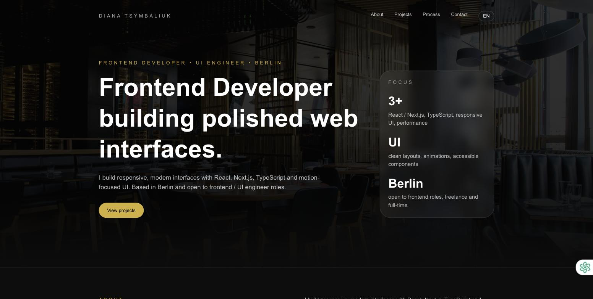

# Diana Tsymbaliuk — Portfolio

**Live: [diana-portfolio-two-roan.vercel.app](https://diana-portfolio-two-roan.vercel.app)**



Personal portfolio site for a Frontend Developer / UI Engineer based in Berlin. The homepage has About, Skills, Projects and Contact sections and links to three working demo apps.

## Features

- English (`/`) and German (`/de`) versions, statically rendered
- **E-commerce Platform** (`/ecommerce`): premium demo store "Luma" with a hero slider, interactive CSS 3D showroom, quick-view pop-ups, product galleries with zoom, wishlist, persistent bag and a three-step checkout. Includes a 30-second 3D video tour (`public/store-tour.mp4`)
- **Dashboard System** (`/dashboard`): admin for the Luma store with plain-language KPIs, an interactive revenue chart (tooltip, previous-period comparison, table view), category split, best sellers, a shopping-hours heatmap and a searchable, sortable orders table with an order-details drawer. Responsive down to phones; orders placed in the store appear live. Includes a 3D video tour (`public/dashboard-tour.mp4`)
- **Brand Website** (`/brand`): restaurant site with menu, gallery and table reservations, managed in an admin view (`/brand/admin`)
- Responsive layout, optimized images (`next/image`), Open Graph preview image, CV download

## Tech Stack

- Next.js 16 (App Router)
- React 19
- TypeScript
- Tailwind CSS

## Run locally

```bash
npm install
npm run dev
```

Open [http://localhost:3000](http://localhost:3000).

## Deploy

Deployed on [Vercel](https://vercel.com).
